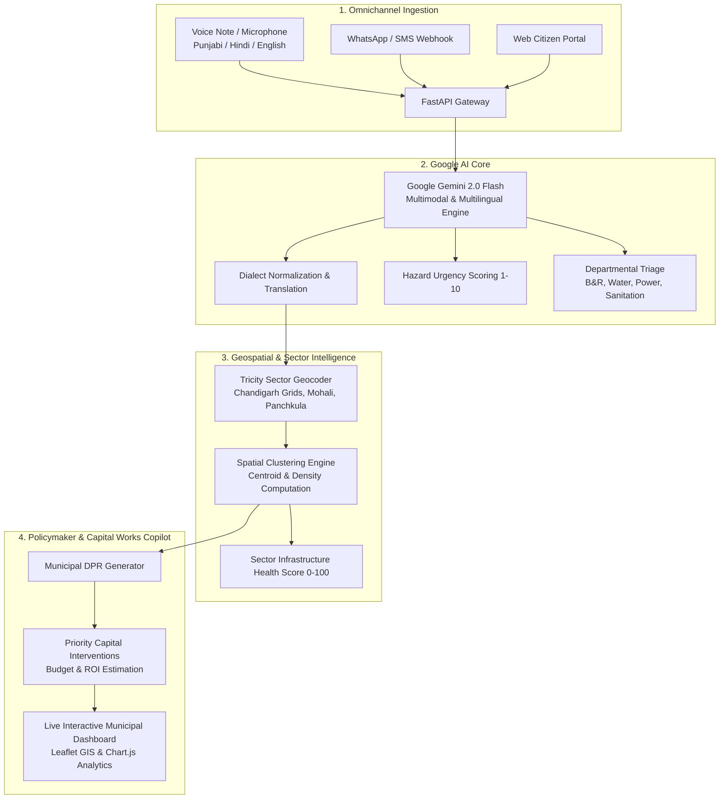

# CivicPulse Tricity — NagrikSetu AI
### Multilingual Citizen Infrastructure Intelligence & Digital Public Infrastructure for Chandigarh, Mohali & Panchkula

[](LICENSE)
[](https://www.python.org/)
[](https://fastapi.tiangolo.com/)
[](https://ai.google.dev/)
[]()
[](Dockerfile)

> **Official Submission for [Code for Communities – Chandigarh Edition](https://hackculture.io/hackathons/code-for-communities-chandigarh)**  
> Organized by **GDG Cloud Chandigarh** & Supported by **Google for Developers**  
> *Category:* AI for Digital Public Infrastructure of Chandigarh | *Bonus Track:* Best Open-Source AI Project  
> *Author:* Sudhir Sharma ([@satanic47](https://github.com/satanic47))

---

## 🏛️ Executive Summary

Governments across India struggle to consolidate citizen feedback and align it with municipal capital spending. Citizen requests live in fragmented systems—WhatsApp chats, helpline recordings, municipal complaint portals, and paper petitions.

**CivicPulse Tricity (NagrikSetu AI)** is a scalable, multilingual AI platform engineered as an open **Digital Public Good (DPG)**. It aggregates citizen development and maintenance requests across **Punjabi, Hindi, and English** via voice, text, and messaging channels.

Powered by **Google Gemini 2.0 Flash**, the platform:
1. Normalizes and translates multilingual citizen complaints in real-time.
2. Performs automated hazard urgency scoring (1–10) and departmental routing.
3. Maps colloquial landmarks to **Le Corbusier Chandigarh Sector grids** (Sectors 1–60, Mohali Phases, and Panchkula).
4. Computes demand hotspots using spatial density clustering.
5. Cross-references citizen demand with census demographics and ward budgets to generate actionable **Municipal Detailed Project Reports (DPRs)** for smart city policymakers.

---

## 🏗️ System Architecture



---

## 🌟 Key Features

### 1. Multilingual Voice & Text Normalization (Punjabi, Hindi, English)
Grassroots citizens often prefer speaking in their native dialect. CivicPulse natively processes Punjabi Gurmukhi (`ਸਾਡੇ ਸੈਕਟਰ 22 ਪਾਣੀ ਦੀ ਪਾਈਪ ਫਟ ਗਈ ਹੈ`), Devanagari Hindi (`सेक्टर 35 सी में सड़क के गड्ढे`), and Hinglish, translating and normalizing them into structured canonical records.

### 2. Le Corbusier Sector Grid Geo-Intelligence
Tricity residents frequently report locations using colloquial landmarks. The geocoding engine automatically maps locations like:
- *"Patel Market"* ➔ **Sector 15** (Lat: `30.7510`, Lng: `76.7620`, Ward: `4`)
- *"Kiran Cinema"* ➔ **Sector 22** (Lat: `30.7300`, Lng: `76.7740`, Ward: `7`)
- *"PU Student Centre"* ➔ **Sector 14** (Lat: `30.7600`, Lng: `76.7640`, Ward: `3`)
- *"Phase 7 Food Street"* ➔ **Phase 7 Mohali** (Lat: `30.7055`, Lng: `76.7125`)

### 3. Hazard Urgency Scoring (1–10)
Immediate public hazards are flagged instantly for rapid dispatch:
- **Urgency 10/10:** Exposed live electrical wires near schools / active short-circuiting.
- **Urgency 9/10:** Main water trunk pipeline rupture / deep collapsed manholes.
- **Urgency 8/10:** Complete street lighting blackout along sensitive corridors.
- **Urgency 5–6/10:** Secondary garbage accumulation / regular road potholes.

### 4. Municipal Capital Works DPR Generator
Rather than viewing complaints in isolation, the Policy Recommender aggregates clusters into formal **Detailed Project Reports (DPRs)**. For example, 18 water complaints in Sector 22 automatically synthesize into:
- **DPR ID:** `DPR-CH-2026-001`
- **Priority Score:** `94.2 / 100` (CRITICAL)
- **Estimated Budget:** `₹23.5 Lakhs`
- **Department:** *Public Health & Water Supply Division*

---

## 🚀 Quickstart Guide

### Option A: Local Python Run

1. **Clone the repository:**
   ```bash
   git clone https://github.com/satanic47/civicpulse-tricity-2-2.git
   cd civicpulse-tricity
   ```

2. **Install dependencies:**
   ```bash
   pip install -r requirements.txt
   ```

3. **Configure Environment:**
   ```bash
   cp .env.example .env
   # Add your Google Gemini API Key from https://aistudio.google.com
   ```
   *(Note: The application includes an intelligent offline deterministic NLP fallback engine and runs out of the box even without an API key!)*

4. **Launch the server:**
   ```bash
   uvicorn app.main:app --host 0.0.0.0 --port 8000 --reload
   ```
   Open **`http://localhost:8000`** in your browser!

---

### Option B: Docker Deployment

```bash
docker compose up -d --build
```
The municipal dashboard will be running at `http://localhost:8000`.

---

## 🧪 Automated Test Suite

CivicPulse Tricity includes a comprehensive test suite covering geocoding, language detection, urgency math, and API endpoints:

```bash
python -m pytest -v
```

**Output:**
```text
tests/test_api.py::test_homepage_render PASSED                           [  4%]
tests/test_api.py::test_list_grievances PASSED                           [  9%]
tests/test_api.py::test_create_grievance PASSED                          [ 14%]
tests/test_api.py::test_get_hotspots PASSED                              [ 19%]
tests/test_api.py::test_get_sectors PASSED                               [ 23%]
tests/test_api.py::test_get_policy_recommendations PASSED                [ 28%]
tests/test_api.py::test_upvote_grievance PASSED                          [ 33%]
tests/test_api.py::test_whatsapp_webhook PASSED                          [ 38%]
tests/test_api.py::test_stats_endpoint PASSED                            [ 42%]
tests/test_gemini_engine.py::test_engine_initialization PASSED           [ 47%]
tests/test_gemini_engine.py::test_punjabi_language_detection_and_classification PASSED [ 52%]
tests/test_gemini_engine.py::test_hindi_language_detection_and_classification PASSED [ 57%]
tests/test_gemini_engine.py::test_critical_urgency_detection PASSED      [ 61%]
tests/test_gemini_engine.py::test_policy_recommendation_generation PASSED [ 66%]
tests/test_geocoding.py::test_resolve_sector_explicit_chandigarh PASSED  [ 71%]
tests/test_geocoding.py::test_resolve_sector_punjabi PASSED              [ 76%]
tests/test_geocoding.py::test_resolve_sector_hindi PASSED                [ 80%]
tests/test_geocoding.py::test_resolve_mohali_phase PASSED                [ 85%]
tests/test_geocoding.py::test_resolve_panchkula_sector PASSED            [ 90%]
tests/test_geocoding.py::test_resolve_landmark PASSED                    [ 95%]
tests/test_geocoding.py::test_resolve_fallback PASSED                    [100%]
======================= 21 passed in 2.74s ========================
```

---

## 📡 REST API Reference

| Endpoint | Method | Description |
| :--- | :--- | :--- |
| `/` | `GET` | Interactive municipal & citizen dashboard |
| `/api/v1/grievances` | `GET` | List grievances with optional sector/category filters |
| `/api/v1/grievances` | `POST` | Ingest new citizen grievance (voice transcript / text) |
| `/api/v1/voice/upload` | `POST` | Upload recorded audio file from mobile/browser |
| `/api/v1/grievances/{id}/upvote` | `POST` | Citizen corroboration upvote |
| `/api/v1/hotspots` | `GET` | Clustered demand hotspots & centroids |
| `/api/v1/sectors` | `GET` | Sector infrastructure health scores & budget metrics |
| `/api/v1/recommendations` | `GET` | Gemini AI-generated Municipal Capital DPRs |
| `/api/v1/webhook/whatsapp` | `POST` | Twilio/WhatsApp citizen messaging webhook |
| `/api/v1/stats` | `GET` | Aggregated analytics & category breakdown |

---

## 📄 License & Open-Source DPG Commitment

This project is licensed under the **MIT License** — see the [LICENSE](LICENSE) file for details.  
Designed in full accordance with the **Digital Public Goods Standard** for global open-source civic innovation.
